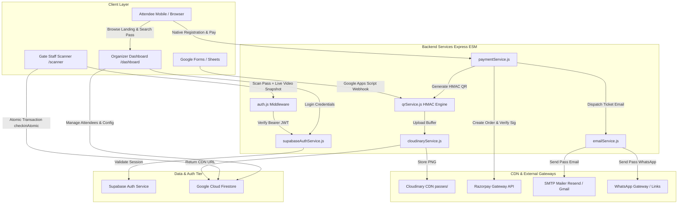
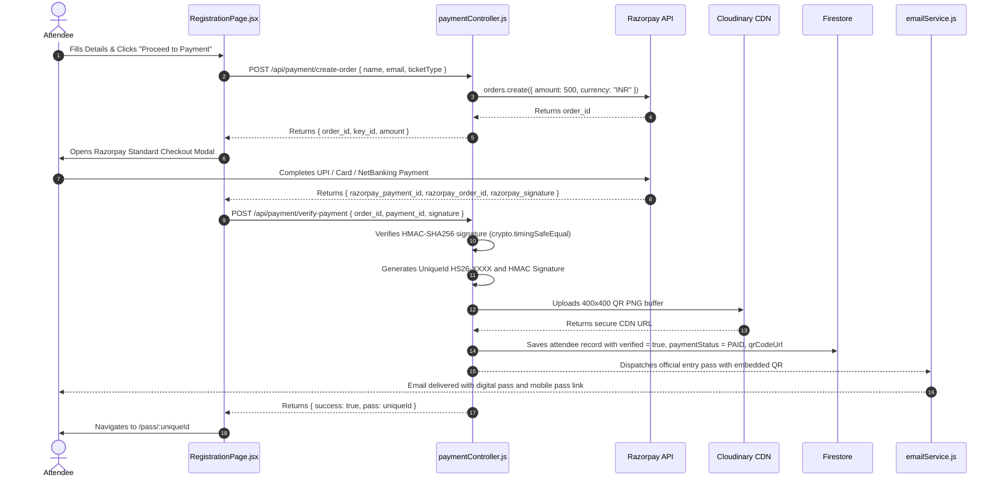
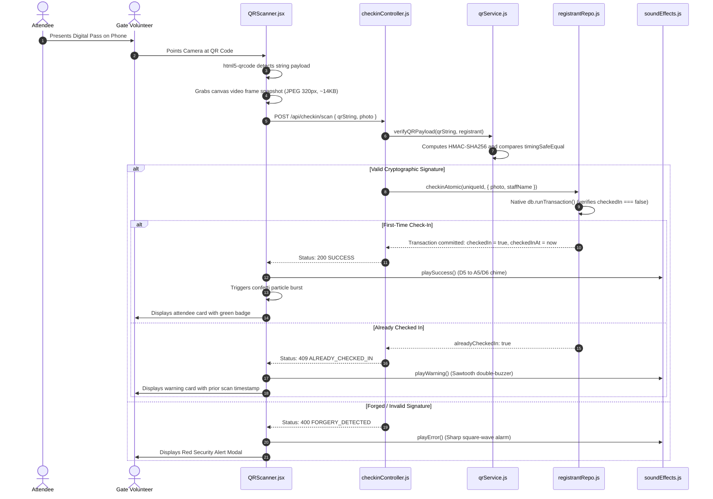

# ⚡ HackSeries 2026 — System Architecture & Workflow Specification

> **System:** HackSeries 2026 Operations Platform  
> **Host Organization:** ACES (Association of Computer Engineering Students)  
> **Institution:** Dr. D. Y. Patil Institute of Technology (DYPDPU), Pimpri, Pune  
> **Lead Operations:** Aditya Renake (`tigeradi1504@gmail.com`)  
> **Architecture Pattern:** Decoupled Monorepo (React SPA + Express ESM API / Vercel Serverless Function)

---

## 1. Technology Stack Overview

### Frontend Architecture
- **Core Framework:** React 18 with modern functional components and hooks (`useState`, `useEffect`, `useCallback`, `useMemo`, `useRef`).
- **Build Tool:** Vite 5 with Hot Module Replacement (HMR) and optimized Rollup chunking.
- **Styling:** Custom Institutional Design System in Vanilla CSS with CSS custom properties (`index.css`), glassmorphism backdrop filters, and holographic animations.
- **Iconography:** `lucide-react` (modern, lightweight SVG icons).
- **Camera Scanning:** `html5-qrcode` (cross-browser WebRTC camera access with back-camera priority).
- **Audio Synthesis:** Zero-dependency native Web Audio API (sine, triangle, and sawtooth tone generators).
- **Celebration Effects:** Canvas-based particle burst (`confettiBurst.js`).
- **Spreadsheet Processing:** `xlsx` library for in-browser Excel/CSV drag-and-drop parsing.

### Backend Architecture
- **Runtime Environment:** Node.js (v20+) with ECMAScript Modules (`"type": "module"`).
- **HTTP Framework:** Express.js 4 with dual-prefix routing (`/api/*` and direct `/*`).
- **Authentication:** **Supabase Auth** (GoTrue JWTs) with privileged Admin SDK (`@supabase/supabase-js`) and role claims stored in `app_metadata`.
- **Media & Pass Storage:** **Cloudinary CDN SDK** (`cloudinary`) for automated PNG QR image uploads and global CDN delivery.
- **Primary Database:** Google Cloud Firestore (via `firebase-admin/firestore`) with zero-config `MemoryFirestore` fallback for offline local development.
- **Payment Gateway:** **Razorpay Node SDK** (`razorpay`) supporting Standard Checkout, automatic signature verification, and webhook handling.
- **Email Delivery:** **Nodemailer** with multi-provider auto-discovery (Resend, SendGrid, Gmail, Outlook, Ethereal).
- **Cryptography:** Node.js native `crypto` module (`crypto.createHmac`, `crypto.timingSafeEqual`).
- **QR Code Generation:** `qrcode` library with Error Correction Level 'H' (High, 30% damage recovery).

### Infrastructure & Deployment
- **Platform:** Vercel Serverless.
- **Serverless Bridge:** `api/index.js` exporting Express handler.
- **Routing & Rewrites:** `vercel.json` directing API calls to serverless endpoints and all browser routes to SPA `index.html`.

---

## 2. Monorepo Directory Structure

```
hackseries-2026/
├── .env                              # Root environment variables
├── .gitignore                        # Git ignore rules (secrets & builds)
├── README.md                         # Main repository readme
├── package.json                      # Monorepo orchestrator (concurrently dev scripts)
├── vercel.json                       # Vercel deployment & rewrite configuration
├── api/
│   └── index.js                      # Serverless bridge for Vercel functions
├── backend/
│   ├── .env                          # Backend private secrets
│   ├── .env.example                  # Template of required environment variables
│   ├── package.json                  # Backend dependencies & npm scripts
│   └── src/
│       ├── app.js                    # Express app initialization & route mounting
│       ├── server.js                 # Standalone HTTP server bootstrap
│       ├── config/
│       │   ├── firebase.js           # Firestore Admin SDK & in-memory fallback
│       │   └── supabase.js           # Supabase client & admin client initialization
│       ├── controllers/
│       │   ├── authController.js     # Staff login & session introspection
│       │   ├── checkinController.js  # Gate scanning, atomic check-in, undo
│       │   ├── emailController.js    # Single & bulk pass email dispatching
│       │   ├── eventController.js    # Club event catalog management (CRUD)
│       │   ├── paymentController.js  # Razorpay orders, webhook, pass minting
│       │   └── registrantController.js# Form webhook, CRUD, bulk import/export
│       ├── middleware/
│       │   ├── auth.js               # Supabase JWT verification & RBAC guards
│       │   └── errorHandler.js       # Global Express error interceptor
│       ├── models/
│       │   ├── configRepo.js         # Event global settings repository
│       │   ├── eventRepo.js          # Multi-event catalog repository
│       │   ├── registrantRepo.js     # Attendee repository with SWR micro-cache
│       │   └── staffRepo.js          # Staff user repository & Bcrypt fallback
│       ├── routes/
│       │   ├── auth.routes.js        # /api/auth routes
│       │   ├── checkin.routes.js     # /api/checkin routes
│       │   ├── email.routes.js       # /api/email routes
│       │   ├── event.routes.js       # /api/event routes
│       │   ├── payment.routes.js     # /api/payment routes
│       │   └── registrant.routes.js  # /api/registrants routes
│       └── services/
│           ├── cloudinaryService.js  # Cloudinary CDN pass image uploader
│           ├── emailService.js       # Nodemailer HTML templates & dispatch
│           ├── messagingService.js   # WhatsApp & SMS notification formatting
│           ├── paymentService.js     # Razorpay API client & signature verification
│           ├── qrService.js          # Cryptographic HMAC QR generator & verifier
│           └── supabaseAuthService.js# Supabase Auth login, provisioning, & verify
├── docs/
│   ├── PRD.md                        # Product Requirements Document
│   ├── architecture.md               # System architecture & workflows (this file)
│   ├── rules.md                      # AI and developer rulebook
│   ├── design.md                     # Design system & UI specifications
│   ├── task.md                       # Task tracker & implementation status
│   └── memory.md                     # Project context, decisions & memory bank
└── frontend/
    ├── .env                          # Frontend environment variables (Vite public keys)
    ├── index.html                    # HTML entry point with meta tags & Google fonts
    ├── package.json                  # Frontend dependencies & Vite scripts
    ├── vite.config.js                # Vite build & local API proxy configuration
    └── src/
        ├── App.jsx                   # Root router, toast queue, persistent background
        ├── index.css                 # Master design system & CSS custom properties
        ├── main.jsx                  # React DOM root entry
        ├── components/
        │   ├── BulkEmailModal.jsx    # Batch pass email dispatcher dialog
        │   ├── EmailTemplateModal.jsx# Live HTML email template preview
        │   ├── ErrorBoundary.jsx     # Global React error catcher
        │   ├── EventsDiscoverySection.jsx # Multi-event browsing cards
        │   ├── ExcelImportModal.jsx  # Drag-and-drop spreadsheet intake
        │   ├── InteractiveBackground.jsx # Floating ambient particle constellation
        │   ├── Navbar.jsx            # Top navigation & route switches
        │   ├── PassPreviewModal.jsx  # Holographic pass preview modal
        │   ├── QRScanner.jsx         # WebRTC camera scanner & photo snapshot
        │   ├── RegistrantTable.jsx   # Attendee table with search & bulk actions
        │   ├── StatCard.jsx          # Dashboard metric counters
        │   ├── SuperAdminModal.jsx   # Master operations console & telemetry
        │   ├── TeamManagementModal.jsx# Staff account manager
        │   └── WebhookGuideModal.jsx # Google Apps Script copy-paste guide
        ├── pages/
        │   ├── DashboardPage.jsx     # Organizer command center
        │   ├── DigitalPassPage.jsx   # Holographic attendee mobile pass
        │   ├── EventLandingPage.jsx  # Public flagship landing page & pass lookup
        │   ├── LoginPage.jsx         # Operations login portal
        │   ├── RegistrationPage.jsx  # Native pass purchase & registration form
        │   └── ScannerPage.jsx       # Dedicated gate check-in console
        ├── services/
        │   └── api.js                # Centralized REST API client
        └── utils/
            ├── confettiBurst.js      # Canvas confetti particle burst
            └── soundEffects.js       # Web Audio API chime & buzzer synthesizer
```

---

## 3. End-to-End System Architecture Diagram



---

## 4. Core Workflows Deep-Dive

### 4.1 In-App Registration & Razorpay Payment Workflow


### 4.2 Gate Scanner & Atomic Check-In Workflow


---

## 5. Data Models & Schemas

### 5.1 Registrant Model (`registrants` collection)
```typescript
interface Registrant {
  _id: string;                      // Clean uppercase uniqueId (e.g., "HS26-9A8B7C")
  uniqueId: string;                 // Official pass ID: HS26-<8 hex chars>
  name: string;                     // Attendee full name
  email: string;                    // Normalized lowercase email
  phone: string;                    // Contact phone number
  ticketType: string;               // "Hacker Pass" | "Student Pass" | "VIP Delegate" | "Judge / Mentor"
  teamName: string;                 // Team name (optional)
  track: string;                    // Hackathon competition track
  institution: string;              // College or organization name
  githubUrl?: string;               // GitHub profile URL
  formResponses?: Record<string, any>; // Full form payload if from Google Forms
  qrPayload: string;                // Tamper-proof token: HS26.v1.<uniqueId>.<signature>
  qrSignature: string;              // 16-char HMAC-SHA256 hex digest
  qrCodeUrl: string;                // Cloudinary HTTPS CDN image URL
  qrCodeDataUrl?: string;           // Fallback base64 data URL
  verified: boolean;                // Admin verification flag
  verificationStatus: string;       // "Verified" | "Not Verified" | "Pending"
  verifiedAt?: string;              // ISO timestamp of verification
  paymentStatus?: string;           // "PAID" | "FREE_PASS" | "PENDING"
  paymentId?: string;               // Razorpay payment ID (e.g., "pay_Pabc123")
  orderId?: string;                 // Razorpay order ID (e.g., "order_Pabc123")
  amountPaid?: number;              // Amount in INR
  paidAt?: string;                  // ISO timestamp of payment confirmation
  checkedIn: boolean;               // Gate check-in status
  checkedInAt?: string;             // ISO timestamp of gate scan
  checkedInBy?: string;             // Staff identifier who completed check-in
  checkedInPhoto?: string;          // Ultra-compressed JPEG base64 gate snapshot
  emailSent: boolean;               // Pass email delivery confirmation
  emailSentAt?: string;             // ISO timestamp of pass delivery
  createdAt: string;                // ISO timestamp of record creation
  updatedAt: string;                // ISO timestamp of last update
}
```

### 5.2 Staff User Model (`staff_users` collection & Supabase Auth)
```typescript
interface StaffUser {
  id: string;                       // Unique identifier / UUID
  username: string;                 // Normalized username (e.g. "adityarenake")
  email: string;                    // Staff email (e.g. "tigeradi1504@gmail.com")
  name: string;                     // Staff display name
  role: 'root_owner' | 'admin' | 'event_head' | 'scanner';
  assignedEventIds: string[];       // Assigned events (['*'] for all)
  lastLogin?: string;               // ISO timestamp of last login
  createdAt: string;
  updatedAt: string;
}
```

---

## 6. Security & Cryptographic Safeguards

1. **HMAC-SHA256 Token Protection:**
   The pass token is structured as:
   $$\text{Token} = \text{HS26.v1.} + \text{UniqueId} + \text{.} + \text{HMAC}_{\text{SHA256}}(\text{"HACKSERIES2026"}\mid\text{UniqueId}\mid\text{Email}\mid\text{TicketType})$$
2. **Side-Channel Timing Attack Immunity:**
   Signatures are verified using Node.js `crypto.timingSafeEqual` with byte buffers.
3. **Atomic Gate Idempotency:**
   Firestore transactions eliminate race conditions during concurrent mobile scanning.
4. **Role Isolation in Supabase Auth:**
   Authorization roles are stored in immutable `app_metadata` claims rather than client-writable `user_metadata`.
5. **Private Key Protection:**
   All secrets (`SUPABASE_SERVICE_ROLE_KEY`, `CLOUDINARY_API_SECRET`, `RAZORPAY_KEY_SECRET`, `QR_SIGNING_SECRET`, `JWT_SECRET`) are strictly kept on the server side and never exposed to the client bundle.
