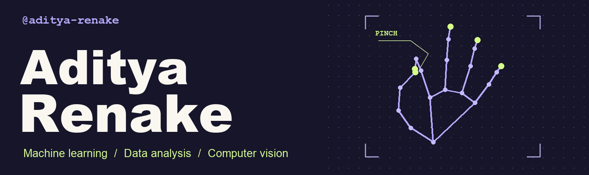

<picture>
  <source media="(prefers-reduced-motion: reduce)" srcset="./profile-banner.png">
  
</picture>

   

## Featured projects

###  Virtual Mouse

Move your pointer with a hand gesture. A webcam tracks the hand and turns its movement into cursor input.

[Virtual Mouse](https://github.com/aditya-renake/Virtual-Mouse) · [MediaPipe experiments](https://github.com/aditya-renake/mediapipe)

###  Eventra

From registration to the venue gate, each attendee carries one signed QR pass. Staff verify it with a browser camera at check-in.

`React` · `Vite` · `Node.js` · `HMAC-SHA256`

[Try Eventra](https://eventra-2026.vercel.app)

© 2026 Aditya Vinod Renake. I am the sole author and copyright owner of Eventra.

###  Sandhi.ai

An osteoarthritis screening prototype that brings movement analysis and patient assessments into one app.

[Sandhi.ai](https://github.com/aditya-renake/sandhi.ai)

## Project directory

| Area | Repositories |
| --- | --- |
| **Computer vision** | [OpenCV examples](https://github.com/aditya-renake/opencv) |
| **Data analysis** | [NumPy](https://github.com/aditya-renake/numpy) · [pandas](https://github.com/aditya-renake/pandas) · [SQL](https://github.com/aditya-renake/SQL) |
| **Apps** | [QR Code Scanner](https://github.com/aditya-renake/qr-code-scanner) · [ZeroDatabase](https://github.com/aditya-renake/zerodatabase) · [NextGen Final](https://github.com/aditya-renake/nextgenfinal) |
| **Hackathons** | [HH Goa 2026](https://github.com/aditya-renake/hh-goa-2026) · [SIH 2026 Backend](https://github.com/aditya-renake/sih-2026-backend) · [Hacktoberfest Final](https://github.com/aditya-renake/Hacktoberfestfinal) · [Napkin Hacktoberfest](https://github.com/aditya-renake/NAPKINHACKTOBERFEST) |
| **Coursework** | [Data Structures and Algorithms](https://github.com/aditya-renake/DSA) · [DSL Prep](https://github.com/aditya-renake/DSL-Prep) · [DSL Lab](https://github.com/aditya-renake/dsllab) · [C++](https://github.com/aditya-renake/cpp) |
| **Interview practice** | [LeetCode Solutions](https://github.com/aditya-renake/leetcode-solutions) · [LeetCode Interview Questions by Company](https://github.com/aditya-renake/leetcode-companywise-interview-questions) |
